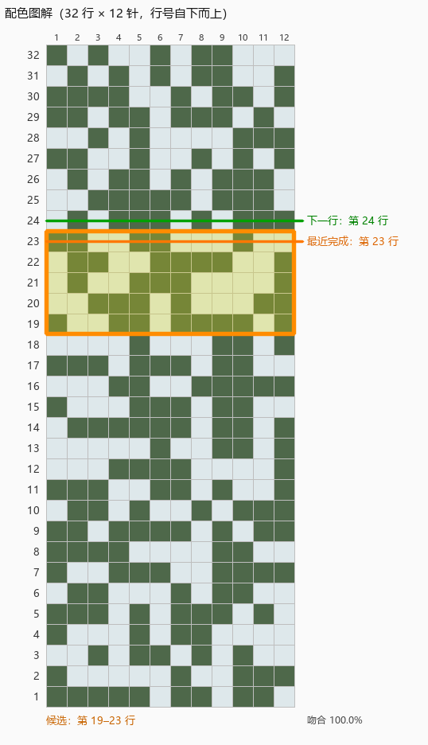
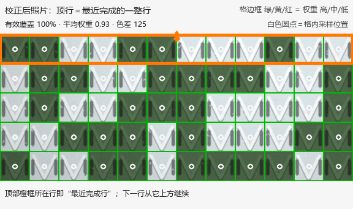
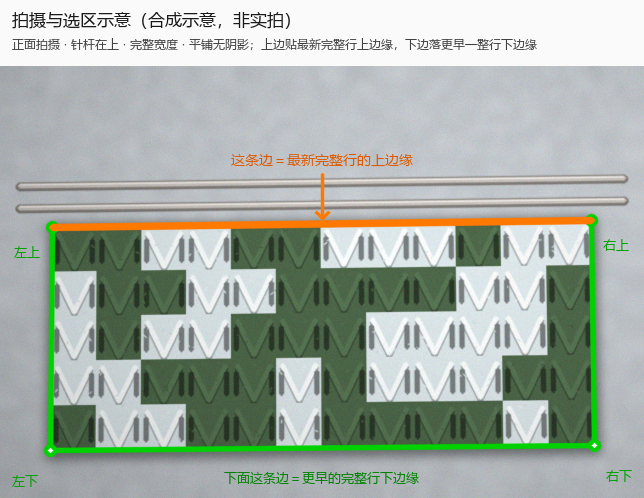

# 织到哪一行了？（Knit Row Locator）

放下织到半途的双色提花织片，再拿起来时忘记该从哪一行继续？
输入**配色方格图解**和**织片正面照片**，应用会把照片对应到图解中的连续行，
高亮显示位置，并回答：

- **最近完成哪一行**
- **下一行从哪里开始**
- 如果花纹重复，**哪些位置都解释得通**，以及如何缩小范围

首版为本地运行的 Python + Streamlit 应用，图片只在本机内存中处理。

## 界面预览

| 图解高亮（唯一候选） | 校正照片与逐格权重 |
|---|---|
|  |  |

重复花纹的演示二会保留全部等价位置（第 4–8、12–16、20–24、28–32 行），
限定「最近完成行 20–26」后只保留第 20–24 行。



> 以上均为程序生成的合成素材，不是实拍照片。实拍验证状态见 [ACCEPTANCE.md](ACCEPTANCE.md)。

## 适用范围

**支持**

- 矩形、固定针数、双色平针提花织片
- 图解一格对应一针；图解宽度 = 照片中织片的完整针数
- 在织完整行后暂停拍照
- 图解为正面配色方格图；照片正面朝相机、针杆在上、能看到完整宽度
- PNG 或 JPEG 输入
- 花纹重复时保留多个候选，并可按「最近完成行」范围缩小

**不支持（留给后续版本）**

- 文字图解、加减针、引返/半行进度
- 只画出一个横向重复单元的图解（无法知道横向重复次数）
- 背面照片、倾斜到无法四点校正的照片、针数被裁掉的照片
- 超过两种颜色的提花

## 快速开始

在项目根目录执行（Windows PowerShell 示例）：

```powershell
python -m venv .venv
.\.venv\Scripts\Activate.ps1
python -m pip install -r requirements.txt

# 可选：样例资源已随仓库提供；需要重建时运行
python examples\build_examples.py

python -m streamlit run app.py
```

浏览器会打开 `http://localhost:8501`。若端口被占用：

```powershell
python -m streamlit run app.py --server.port 8511
```

也可以直接运行 `.\run.ps1`：脚本会在需要时创建 `.venv`、安装依赖、生成样例并启动应用
（如 PowerShell 禁止本地脚本，请按上面的手动命令执行）。

运行自动化测试：

```powershell
python -m pytest -q
```

本次交付的实测结果为 **81 passed**（Python 3.12，Streamlit 1.67，OpenCV 5.1）。
详细环境、命令与第一版验收记录见 [ACCEPTANCE.md](ACCEPTANCE.md)，
第二轮修复与基线复验见 [REVERIFICATION.md](REVERIFICATION.md)。

## 可复现研究基线（CLI）

界面之外提供一个不依赖 Streamlit 的命令行入口，对内置案例输出和界面相同的候选：

```powershell
# 全部案例 + 预注册范围场景，文本摘要
python cli.py --all --scenarios

# 结构化 JSON，并写入运行产物
python cli.py --all --scenarios --json --out docs/baseline_results.json

# 单个案例 + 最近完成行范围
python cli.py --case case2_repeat --row-range 20-26 --json
```

记录内容包括：样例来源（图解/照片/种子/合成或实拍）、预期停织行、全部候选窗口、
最近完成行、下一行、状态、得分、有效覆盖率、差异格数、当前阈值和单次运行耗时。
重复花纹按**候选集**验收（`expected_check.comparison = candidate_set`），
不会把任意一个并列候选当成唯一真值。

本轮实际产物：[`docs/baseline_results.json`](docs/baseline_results.json)。当前内置案例均为
**合成素材**；运行耗时是单机单次结果，不是实拍性能结论。

实拍样本填写 [`docs/real_photo_capture_template.md`](docs/real_photo_capture_template.md)
与 [`docs/real_photo_manifest_template.json`](docs/real_photo_manifest_template.json) 后，可用：

```powershell
python cli.py --manifest data/real_round1/manifest.json --json `
  --out reports/real_round1/predictions.json
```

## 两个一键演示

首页提供两个按钮：

| 演示 | 内容 | 预期结果 |
|---|---|---|
| 演示一：唯一位置 | 图解 32 行 × 12 针，照片可见 5 行；第 19–23 行的小图案在整张图中唯一（整体换色后也唯一） | 唯一候选：第 19–23 行，**最近完成 23，下一行 24**，吻合度 100% |
| 演示二：重复花纹 | 花纹每 8 行重复一次；照片实际停在第 24 行 | 多个候选：第 4–8、12–16、20–24、28–32 行；在上方勾选范围并填 20–26 后，唯一锁定第 20–24 行（最近完成 24，下一行 25） |

候选切换按**当前候选**判断末行：切到第 28–32 行时，界面显示
“若此候选正确，图解已完成”，不会再出现不存在的“下一行 33”；
切回第 20–24 行时恢复“下一行 25”。唯一候选到达末行时显示“图解已完成”。

也可以直接用深链接打开：

- `http://localhost:8501/?case=case1_unique`
- `http://localhost:8501/?case=case2_repeat`
- `http://localhost:8501/?case=case2_repeat&range=20-26`（打开即按范围缩小）

界面会弹出「与演示预期一致。✓」，并显示该合成素材的已知停织行，便于核对。

## 拍摄方法与选区

1. **正面拍摄**：镜头正对织片，针杆在上，不要从侧面或背面拍。
2. **完整宽度**：左右两侧最外一针都在画面内；上下可以超出，但左右不能裁掉针目。
3. **平铺**：放在平整、纯色背景上，避免手指、阴影、强反光压住针目。
4. **标记四角**：左上 → 右上 → 右下 → 左下。
   - 上方边贴着**最新完成整行**的上边缘；
   - 下方边落在**更早一整行**的下边缘；
   - 可见完整行数 = 两条边之间的行数。
5. **输入行列数**：行数是可见完整行数，针数是照片中织片的完整宽度针数。

图解选区是**网格外边界**：如果图解有白边，把选区收到网格范围内。界面里的
「白点」就是每格的实际采样位置，行号自下而上标注，可据此确认选区是否正确。

## 结果怎么读

| 状态 | 含义 | 界面行为 |
|---|---|---|
| 唯一候选 | 只有一个窗口能解释照片中的配色 | 高亮该窗口，给出最近完成行/下一行 |
| 多个候选 | 多个窗口分数相同或接近（分差 ≤ 2 个百分点） | 列出全部候选，可用下拉框逐个查看，或限定行号范围 |
| 证据不足 | 有效覆盖率、吻合度不足，或没有合法窗口 | 不高亮行号，说明原因并提示检查选区/行数/补拍 |
| 输入错误 | 观测高于图解、针数不一致、范围非法等 | 指出具体尺寸或参数问题 |

**分数定义**（与代码一致）：

- 每个窗口比较两种整块一致的颜色映射：颜色相同、或两种颜色整体互换。
- 分数 = 颜色一致的格子权重之和 ÷ 有效格子权重之和，取两种映射中的较大值。
- 有效覆盖率 = 权重高于阈值的格子占比。
- 逐格权重 0–1：0 表示没有可用证据；照片预览中绿框 ≥0.7、黄框 0.35–0.7、红框 <0.35。

**行号换算**：高度为 `h` 的观测匹配到零基起点 `s`，覆盖图解第 `s+1` 至 `s+h` 行；
最近完成行 = `s+h`，下一行 = `s+h+1`。若 `s+h` 已是图解最后一行，界面显示「图解已完成」。

## 阈值与初始取值依据

集中配置在 [`core/config.py`](core/config.py)，界面与 README 使用同一组值。

| 参数 | 默认值 | 依据 |
|---|---|---|
| `min_coverage` | 0.60 | 至少六成格子有颜色证据；低于此值时行号容易被少数清晰格子左右，宁可不答 |
| `min_score` | 0.82 | 干净合成样例接近 1.0；实拍吻合度尚无配对实测数据，0.82 是待实拍校准的保守初始值；随机双色期望约 0.5 |
| `ambiguity_margin` | 0.02 | 候选分差 ≤2 个百分点视为“相同或接近”，保留歧义而不是按小数差强行挑一个 |
| `min_cell_weight` | 0.15 | 权重过低的格子不参与评分，避免阴影/混色格污染分数 |
| 照片 `cell_px` | 48 | 校正后每格 48 像素；每格取 5×5 个采样点 |
| 照片 `min_source_cell_px` | 3.0 | 源图每格至少 3×3 像素，低于此判定分辨率过低 |
| 照片 `color_separation_min` | 8.0（Lab） | 两种织线颜色过近时整体置零权重并提示重拍 |

这些是首版经验值，只在合成素材上校准过；真实照片验证后应重新评估（见验收记录）。

## 数据约定与接口

矩阵形状为 **行数 × 针数**：

- 内部第 0 行 = 图解**底部**第 1 行；第 0 列 = 正面观察时最左侧的一针。
- 图像模块负责从屏幕坐标（图片第 0 行在顶部）转换到内部顺序：读图解时上下翻转，
  读照片时同样翻转，使观测内部第 0 行对应观测区最下面一行。
- 图像数组统一为 OpenCV BGR；调色板也用 BGR 保存，显示时转 RGB。
- 权重范围 0–1，0 表示无证据。
- `row_range` 限制的是**最近完成行（一基）**，例如 `(20, 26)`。

### 最小调用示例

```python
import json
from pathlib import Path

from core.chart import read_chart
from core.imageio import load_image
from core.match import match
from core.photo import read_photo

case_dir = Path("examples/case1_unique")
case = json.loads((case_dir / "case.json").read_text(encoding="utf-8"))

chart_result = read_chart(
    load_image(case_dir / "chart.png"),
    tuple(case["chart"]["rect"]),
    case["chart"]["rows"],
    case["chart"]["stitches"],
)
photo_result = read_photo(
    load_image(case_dir / "photo.png"),
    tuple(tuple(p) for p in case["photo"]["corners"]),
    case["photo"]["stitches"],
    case["photo"]["rows"],
)
result = match(chart_result.chart, photo_result.observed, row_range=None)

print(result.status)              # unique
print(result.last_completed_row)  # 23
print(result.next_row)            # 24
print(result.reason)
```

接口职责：

| 模块 | 职责 |
|---|---|
| `app.py` | 上传、框选、角点预览、演示、会话与旧结果失效 |
| `core/types.py` | `ChartGrid`、`ObservedGrid`、`Candidate`、`MatchResult` 与坐标约定 |
| `core/chart.py` | 裁出图解网格、避开网格线、提取双色矩阵与网格坐标 |
| `core/photo.py` | 四点透视校正、格内多次采样、颜色分类、逐格权重与质量提示 |
| `core/match.py` | 纯函数 `match(chart, observation, row_range=None)`，返回候选与状态 |
| `core/progress.py` | 按当前候选判断是否到达末行，统一界面与 CLI 的“下一行/已完成”展示 |
| `core/pipeline.py` | 把读取→校正→匹配串成可测试流程，加载演示样例 |
| `core/render.py` | 图解高亮渲染（候选行、最近完成行、差异格） |
| `cli.py` | 可复现基线命令行：内置案例/实拍 manifest、结构化 JSON、候选集验收 |

## 目录结构

```text
knit-row-locator/
├─ app.py                     # Streamlit 界面
├─ cli.py                     # 可复现基线 CLI（内置案例/实拍 manifest）
├─ core/                      # 算法（types/chart/photo/match/progress/pipeline/render/synth）
├─ examples/
│  ├─ build_examples.py       # 确定性生成两份演示素材
│  ├─ case1_unique/           # 图解、照片、矩阵、expected.json
│  └─ case2_repeat/
├─ data/README.md             # 实拍素材的本地目录约定（真实图片默认不提交）
├─ tests/                     # 81 个 pytest 用例（含 Streamlit AppTest 与 CLI）
├─ docs/                      # 组件预览、拍摄示意、基线产物、实拍模板
├─ README.md
├─ ACCEPTANCE.md              # 第一版验收
├─ REVERIFICATION.md          # 第二轮修复与基线复验
└─ requirements.txt
```

## 素材来源与验证状态

- 所有演示图片由 [`examples/build_examples.py`](examples/build_examples.py) 使用固定随机种子生成，
  属于**合成渲染**，不是实拍；详见 [examples/README.md](examples/README.md)。
- 合成素材覆盖：正确唯一定位、正确保留多候选、证据不足、整体换色、较强透视/噪声、JPEG 压缩、
  模糊与低对比度降权。
- **实拍定位能力待验证**：仓库中没有配对实拍材料。采集模板、
  逐样本 CSV 和 manifest 模板见 [`docs/real_photo_capture_template.md`](docs/real_photo_capture_template.md)；
  补测需要同一织片的原图解、完整宽度正面照，以及拍照时独立记录的停织行号。
  第一轮实拍状态与失败样本记录规则见 [REVERIFICATION.md](REVERIFICATION.md)。

## 已知限制

- 依赖用户框选和四角标注的准确性；首版不做自动网格/边界检测。
- 仅支持两种颜色、平针、固定针数；不处理加减针或半行。
- 图解与照片都必须是正立方向（针杆在上）；旋转 180° 的照片需要先转正。
- 重复花纹只能保留歧义或靠用户给定范围缩小，无法从单张照片中唯一确定真实进度。
- 阈值只在合成素材上校准；真实照片可能需要在 `core/config.py` 中调整。

## 隐私

图片仅在本地进程内存中处理，不上传到任何服务器；应用没有网络请求。
